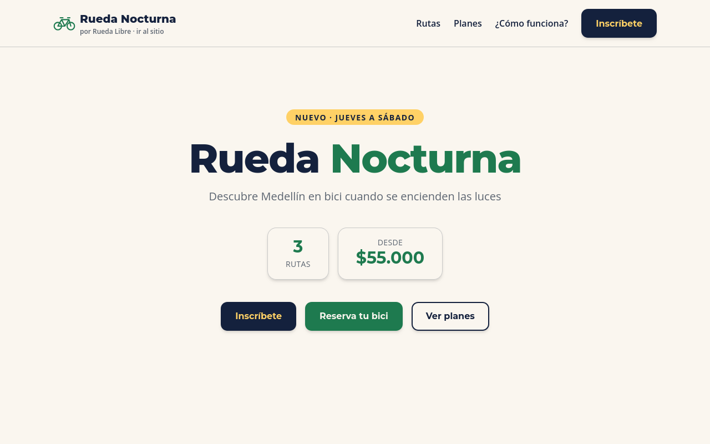
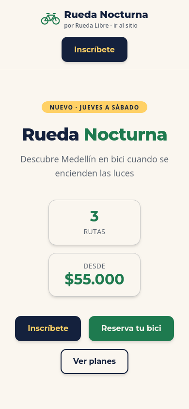

# Rueda Libre · Sitio v2.0 + landing Rueda Nocturna

Ecosistema web de **Rueda Libre**, servicio de alquiler de bicicletas en Medellín. Tiene dos productos conectados:

- **Sitio v2.0** (Bootstrap 5): inicio, tarifas y reservas de bicicletas.
- **Rueda Nocturna** (Tailwind CSS 4): landing de la campaña de rutas nocturnas, con inscripción en línea, planes y modo oscuro.

Ambos comparten la marca: los mismos colores, las mismas fuentes (Montserrat y Open Sans) y los mismos datos de contacto. Además se enlazan entre sí desde la navbar, el carrusel, el logo y el botón "Reserva tu bici".

## Enlaces publicados

| Página | Enlace |
|--------|--------|
| Sitio v2.0 (inicio) | https://alexruiz0906.github.io/rueda-libre/ |
| Landing Rueda Nocturna | https://alexruiz0906.github.io/rueda-libre/nocturna/ |
| Kit de componentes | https://alexruiz0906.github.io/rueda-libre/nocturna/componentes.html |
| Reservas | https://alexruiz0906.github.io/rueda-libre/paginas/reservas.html |

Repositorio: https://github.com/Alexruiz0906/rueda-libre

## Páginas

| Archivo | Contenido |
|---------|-----------|
| [`index.html`](index.html) | Inicio del sitio: carrusel de promociones (la 4.ª diapositiva lleva a Rueda Nocturna), rutas, servicios y flota |
| [`paginas/tarifas.html`](paginas/tarifas.html) | Tarifas de bicicletas y recorridos |
| [`paginas/reservas.html`](paginas/reservas.html) | Formulario de reserva con validación nativa y modal de políticas |
| [`nocturna/index.html`](nocturna/index.html) | Landing: rutas, planes, "¿Cómo funciona?", inscripción y pie |
| [`nocturna/componentes.html`](nocturna/componentes.html) | Kit de componentes: botones, card, etiquetas, alertas y campos, con las reglas del kit |
| [`bitacora.txt`](bitacora.txt) | Bitácora completa del proyecto: decisiones, mediciones y pruebas |

## Tecnologías

- HTML5 semántico y accesible (WCAG: contraste, foco visible, etiquetas y roles ARIA)
- **Bootstrap 5.3.8** y Bootstrap Icons (sitio v2.0), con CSS propio basado en variables `--bs-*`
- **Tailwind CSS 4.3.5** con `@tailwindcss/cli` (landing): `@theme`, `dark:`, `@layer components` y `@apply`
- Google Fonts: Montserrat (títulos) y Open Sans (texto)
- Node.js y npm, GitHub Pages, validador del W3C y DevTools

### Cómo trabajar con la landing

```bash
cd nocturna
npm install
npm run dev     # observa los HTML y regenera src/output.css (--watch)
npm run build   # genera src/output.css minificado para publicar (--minify)
```

> GitHub Pages no ejecuta la CLI, así que `nocturna/src/output.css` se sube al repositorio. `node_modules/` está excluido con `.gitignore`.

## Paleta de la marca

| Nombre | Código | Uso |
|--------|--------|-----|
| Azul Noche | `#14213D` | Texto principal, fondo en modo oscuro |
| Crema | `#FAF6EF` | Fondo en modo claro, texto en modo oscuro |
| Verde Ruta | `#1E7A4F` | Botón secundario, precios, foco (claro) |
| Naranja Pedal | `#F39A2B` | Hover, nivel difícil, advertencias |
| Gris Asfalto | `#5B6470` | Texto secundario |
| Amarillo Farol | `#FFD166` | Color de campaña, botón principal y foco en modo oscuro |

## Recomendación de framework (MiniReto 8)

| Criterio | Bootstrap (sitio v2.0) | Tailwind (Rueda Nocturna) |
|----------|------------------------|---------------------------|
| Curva de aprendizaje | Más rápida al inicio: se copian componentes listos | Más lenta al inicio (utilidades, CLI y Node), luego muy ágil |
| Personalización | Hay que sobrescribir variables `--bs-*` y clases | `@theme` con los colores y fuentes de la marca, y `dark:` integrado |
| Tamaño final | ≈ 403 KB (CSS + JS + iconos; ~68 KB con gzip) | ≈ 31 KB de CSS minificado (~5 KB con gzip) y 0 KB de JS |
| Casos de uso | Sitios con componentes interactivos listos (modal, carrusel, collapse) | Diseños de marca propios, landings y sitios donde importa el peso |

**Recomendación: Tailwind** para la próxima versión de todo el sitio. La mayor parte del tráfico llega desde celulares, y el cliente quiere su identidad visual y modo oscuro. Con Tailwind el CSS es unas 13 veces más liviano, no carga JavaScript y el tema de la marca vive en un solo lugar. Los componentes que hoy resuelve el JS de Bootstrap se pueden reemplazar con HTML nativo (`<dialog>`, `<details>`, scroll-snap). La condición es mantener el kit de componentes y sus reglas.

## Capturas

**Landing en escritorio (modo claro)**



**Landing en celular (390 px)**



**Landing en modo oscuro**


**Sitio v2.0 con el enlace a Rueda Nocturna en la navbar**


## Calidad y verificación

- Validador del W3C: **0 errores y 0 avisos** en las 5 páginas.
- 80 enlaces y recursos locales revisados (incluidas las anclas `#id`): **0 rotos**.
- Sin estilos en línea (`style=""`).
- Contraste WCAG ≥ 4,5:1 en todas las combinaciones de texto, en modo claro y en modo oscuro.
- Responsive revisado a 360, 768, 1024 y 1280 px.

## Aprendizajes

- Tailwind solo genera las clases que encuentra escritas en el HTML: por eso el CSS es tan pequeño, y por eso las clases no se pueden armar concatenando textos.
- Mobile-first: se escribe primero el celular sin prefijo y luego se agregan `sm:`, `md:` y `lg:`.
- Un color de marca puede fallar en modo oscuro: Verde Ruta sobre Azul Noche da 3,01:1. Hay que medir, no suponer.
- `@apply` mejora la legibilidad del HTML pero no reduce el CSS, porque copia las declaraciones. Conviene usarlo con moderación.
- Un kit con reglas claras (radios, espaciado y colores) hace que las secciones nuevas, como los planes o el formulario, se armen rápido y queden consistentes.
- La validación nativa del navegador (`required`, `pattern`, `min`/`max`, `minlength`) cubre la mayoría de los casos sin JavaScript.

## Autor

**Alexruiz0906** · Proyecto formativo Riwi, 2026. Bitácora detallada en [`bitacora.txt`](bitacora.txt).
